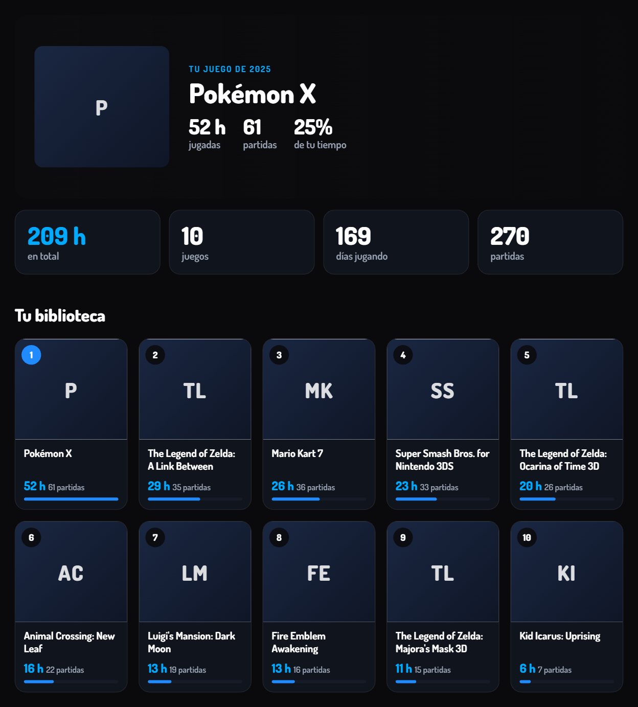
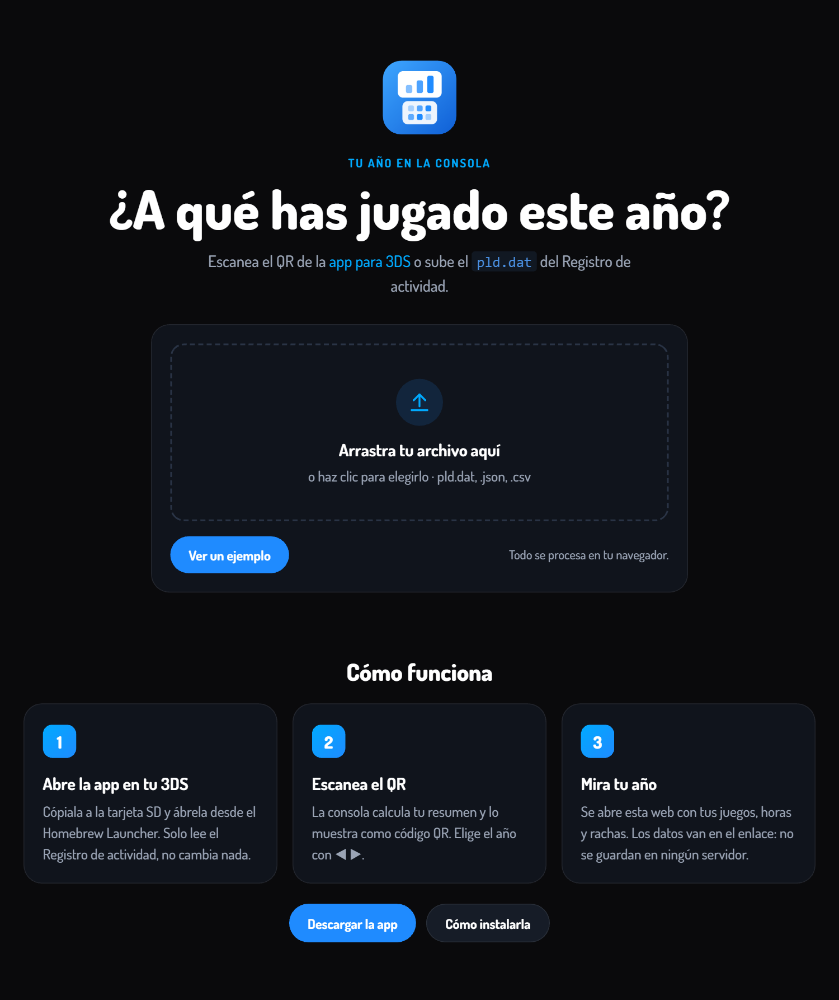
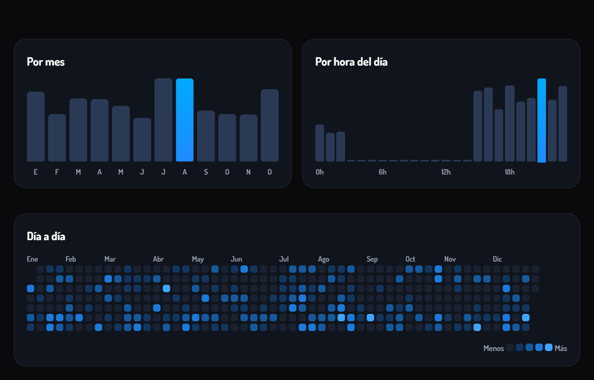
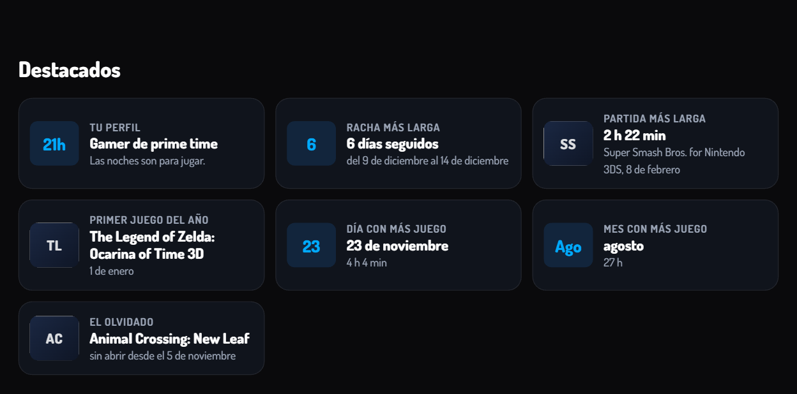
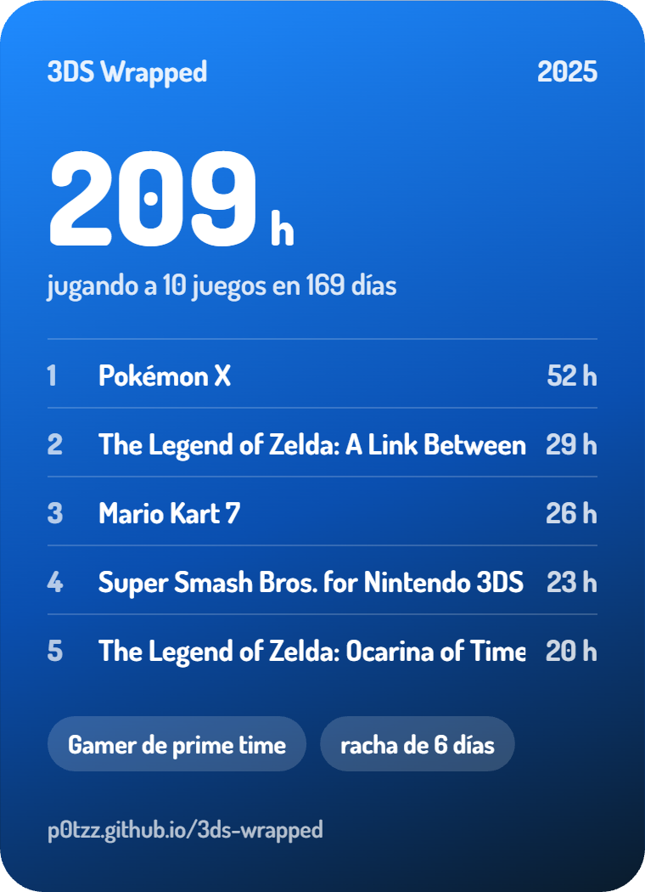



  

<h1 align="center">3DS Wrapped</h1>

  Tu año en la 3DS al estilo «Wrapped»: juegos más jugados, horas, rachas y una tarjeta para compartir.

  
  
  

  <a href="https://p0tzz.github.io/3ds-wrapped/"><b>Abrir la web</b></a> ·
  <a href="https://github.com/P0tzz/3ds-wrapped/releases/latest"><b>Descargar la app</b></a> ·
  <a href="#preguntas-frecuentes">Preguntas frecuentes</a>

  

## Cómo funciona

| | |
|---|---|
| **1. Abre la app en tu 3DS** | Lee el Registro de actividad de la consola. Solo lee: no cambia nada. |
| **2. Escanea el QR** | La consola calcula tu resumen del año y lo muestra como código QR. |
| **3. Mira tu año** | El móvil abre la web con tus juegos, horas y rachas, con las portadas. |

Los datos van dentro del propio enlace del QR. No hay cuentas ni servidores: nada se guarda fuera de tu móvil.

## Instalar la app

Necesitas una 3DS con CFW (Luma3DS) y el Homebrew Launcher.

1. Descarga **`3ds-wrapped.3dsx`** de la [última versión](https://github.com/P0tzz/3ds-wrapped/releases/latest).
2. Cópialo a la carpeta **`3ds`** de la tarjeta SD.
3. Ábrelo desde el Homebrew Launcher.

Más detalles, controles y solución de problemas: [guía de la app](homebrew/README.md).

## Capturas

<table>
  <tr>
    <td width="50%"></td>
    <td width="50%"></td>
  </tr>
  <tr>
    <td align="center">Inicio</td>
    <td align="center">Por mes, por hora y día a día</td>
  </tr>
  <tr>
    <td width="50%"></td>
    <td width="50%" align="center"></td>
  </tr>
  <tr>
    <td align="center">Destacados</td>
    <td align="center">Tarjeta para compartir</td>
  </tr>
</table>

## Qué muestra

- Horas totales, juegos, días jugados y partidas.
- Tu juego del año y tu biblioteca, con la portada de cada juego.
- Horas por mes y por hora del día, y un calendario con todo el año.
- Racha más larga, partida más larga, día con más juego, primer juego del año y el más olvidado.
- Una tarjeta para descargar o compartir directamente desde el móvil.

Reconoce juegos de 3DS, de DS, DSiWare, homebrew (FBI, Checkpoint, PKSM…) y apps del sistema.

## Preguntas frecuentes

**¿Necesito la consola hackeada?**
Sí. El Registro de actividad es un guardado del sistema y solo se puede leer con homebrew.

**¿Se suben mis datos a algún sitio?**
No. La app mete el resumen en el enlace del QR y la web lo calcula todo en tu navegador.

**Un juego de DS sale como «Juegos de DS (TWiLight / flashcart)».**
Los juegos abiertos desde TWiLight Menu++ o un flashcart se guardan en la consola sin decir cuál era.
En la web, pulsa «¿Qué juego es?» en esa tarjeta y elígelo.

**El móvil no lee el QR.**
Acerca el móvil hasta que el código ocupe casi toda la pantalla y sube el brillo de la consola.
El enlace también se guarda en `sd:/3ds/3ds-wrapped/enlace.txt` para abrirlo desde el PC.

**Mis horas no están al día.**
La consola solo actualiza el registro al abrir la app *Registro de actividad*. Ábrela una vez antes de usar 3DS Wrapped.

**Algo sale mal o falta un nombre.**
Abre un [issue](https://github.com/P0tzz/3ds-wrapped/issues/new/choose) y adjunta `sd:/3ds/3ds-wrapped/diagnostico.txt`, que la app crea cada vez que se abre.

## Sin la app

En la web también puedes subir el `pld.dat` del Registro de actividad (copiado con JKSM o Checkpoint) o tus datos en JSON o CSV.
Cómo sacarlo y el formato de los archivos: [docs/FORMATO.md](docs/FORMATO.md).

## Desarrollo

| Carpeta | Qué hay |
|---|---|
| `index.html`, `css/`, `js/` | La web (HTML, CSS y JavaScript, sin compilar) |
| `homebrew/` | La app para 3DS en C con libctru |
| `data/ds-titles.json` | Nombres de juegos de DS por código |
| `docs/` | Formato de los datos y del enlace del QR |

Web en local: cualquier servidor estático, por ejemplo `python -m http.server`.
App: con [devkitPro](https://devkitpro.org/wiki/Getting_Started) instalado, `make -C homebrew`. GitHub Actions la compila y prueba en cada cambio.

Formato del enlace del QR: [docs/QR.md](docs/QR.md). Cambios entre versiones: [CHANGELOG.md](CHANGELOG.md).

## Créditos

- [HarshNarayanJha/3DS-ActivityLog](https://github.com/HarshNarayanJha/3DS-ActivityLog): formato de `pld.dat`.
- [Ryuzaki-MrL/Cthulhu](https://github.com/Ryuzaki-MrL/Cthulhu): ubicación del guardado y de la caché de iconos.
- [hax0kartik/3dsdb](https://github.com/hax0kartik/3dsdb): nombres de juegos de 3DS.
- [GameTDB](https://www.gametdb.com/): portadas (se cargan desde su web) y nombres de juegos de DS.
- [nayuki/QR-Code-generator](https://github.com/nayuki/QR-Code-generator) (MIT), [html2canvas](https://html2canvas.hertzen.com/) y la fuente [Dosis](https://fonts.google.com/specimen/Dosis).

## Licencia

[MIT](LICENSE). Proyecto de fans, sin relación con Nintendo.
