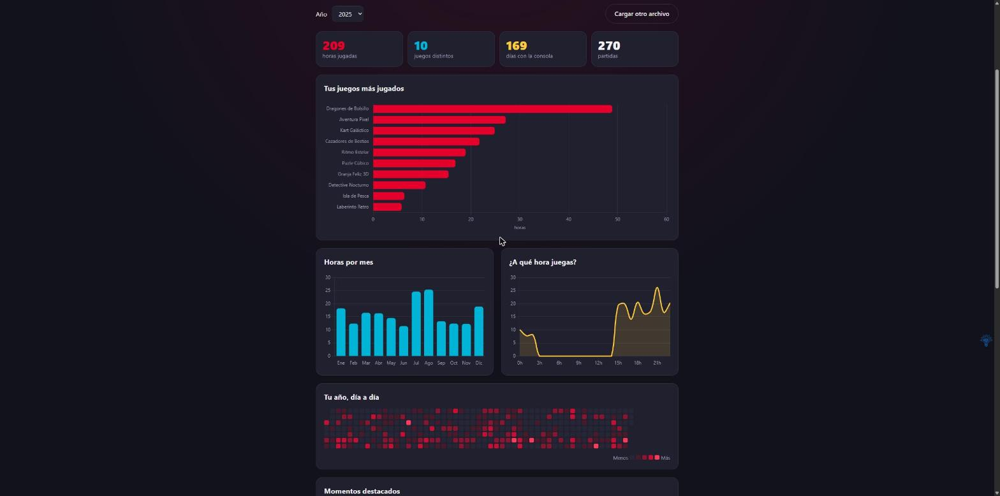

# 3ds-wrapped

Resumen anual de tu historial de juego en 3DS, estilo "Wrapped".

**Demo:** https://p0tzz.github.io/3ds-wrapped/



## Qué muestra

- Horas totales, juegos, días jugados y partidas
- Top 10 de juegos
- Horas por mes y por hora del día
- Mapa de calor del año
- Racha más larga, partida más larga, etc.
- Tarjeta exportable a PNG

Todo se procesa en local, no se sube nada a ningún servidor.

## Uso

Abre `index.html` o la demo y carga un archivo `.json` o `.csv`.
Hay ejemplos en [`ejemplos/`](ejemplos) y el formato está en [docs/FORMATO.md](docs/FORMATO.md).

Para desarrollo cualquier servidor estático vale:

```
python -m http.server
```

## TODO

- [ ] Leer `pld.dat` (Activity Log) directamente
- [ ] Comparar años
- [ ] Tema claro
- [ ] Traducción al inglés

PRs bienvenidos.

## Créditos

- [3dbrew](https://www.3dbrew.org/) por la documentación del sistema
- [Chart.js](https://www.chartjs.org/)
- [html2canvas](https://html2canvas.hertzen.com/)

## Licencia

MIT. Proyecto no afiliado a Nintendo.
