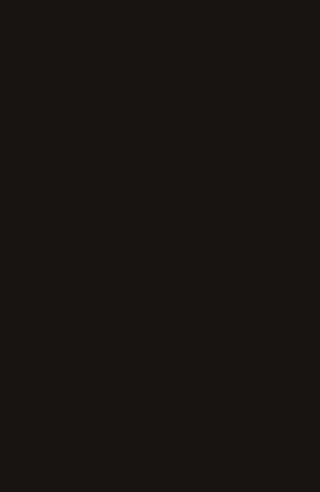

# 3ds-wrapped

Resumen anual de tu historial de juego en 3DS, estilo "Wrapped".

**Demo:** https://p0tzz.github.io/3ds-wrapped/



## Qué muestra

- Horas totales, juegos, días jugados y partidas
- Top 10 de juegos
- Horas por mes y por hora del día
- Mapa de calor del año
- Racha más larga, partida más larga, etc.
- Tarjeta exportable a PNG

Todo se procesa en local, no se sube nada a ningún servidor.

## Uso

**Desde la consola (lo más fácil):** instala la [app para 3DS](homebrew/), ábrela y escanea el QR con el móvil.

**Desde el PC:** abre la web y carga el `pld.dat` de tu consola (o un `.json` / `.csv`).
Cómo sacar el `pld.dat` y el formato de los demás archivos: [docs/FORMATO.md](docs/FORMATO.md).

Para desarrollo cualquier servidor estático vale:

```
python -m http.server
```

## TODO

- [x] Leer `pld.dat` (Activity Log) directamente
- [x] App para 3DS con QR
- [x] Tema claro y oscuro (según el sistema)
- [ ] Probar con más `pld.dat` reales
- [ ] Comparar años
- [ ] Traducción al inglés

PRs bienvenidos.

## Créditos

- [HarshNarayanJha/3DS-ActivityLog](https://github.com/HarshNarayanJha/3DS-ActivityLog) por documentar el formato de `pld.dat`
- [hax0kartik/3dsdb](https://github.com/hax0kartik/3dsdb) para los nombres de los juegos
- [3dbrew](https://www.3dbrew.org/)
- [GameTDB](https://www.gametdb.com/) para las portadas (se cargan desde su web, no están en el repo)
- [html2canvas](https://html2canvas.hertzen.com/)
- Fuente [Dosis](https://fonts.google.com/specimen/Dosis)

## Licencia

MIT. Proyecto no afiliado a Nintendo.
